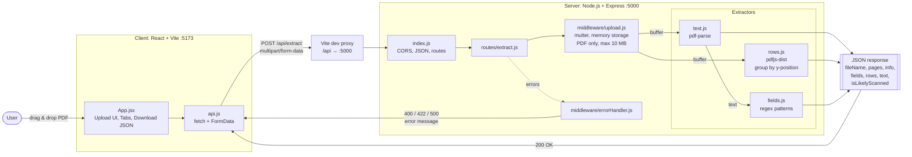
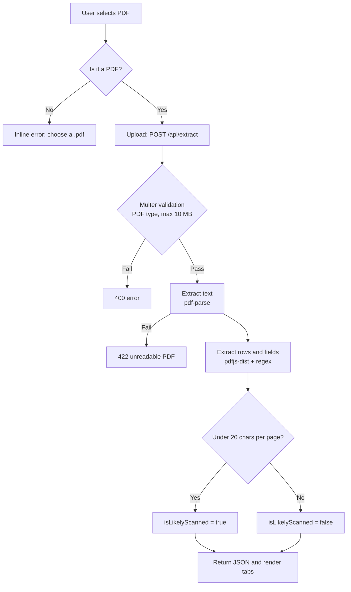

# pdf-extract

Upload a PDF in a React client, extract text, structured fields and table-like rows in an Express server.

## Run

```bash
# Terminal 1
cd server
npm install
npm run dev        # http://localhost:5000

# Terminal 2
cd client
npm install
npm run dev        # http://localhost:5173

```

## Folder structure

```
pdf-extract/
├── client/                 React + Vite
│   ├── index.html
│   ├── vite.config.js      proxies /api → :5000
│   └── src/
│       ├── main.jsx
│       ├── App.jsx         upload UI, result tabs
│       ├── api.js          extractPdf()
│       └── styles.css
└── server/                 Node.js + Express
    ├── .env                PORT, CLIENT_ORIGIN, MAX_FILE_MB
    └── src/
        ├── index.js        app setup
        ├── routes/extract.js
        ├── middleware/
        │   ├── upload.js       multer config
        │   └── errorHandler.js
        └── extractors/
            ├── text.js     pdf-parse
            ├── rows.js     pdfjs-dist
            └── fields.js   regex fields
```

The Vite dev server proxies `/api` to the Express server, so no CORS setup is needed in development.

## API

`POST /api/extract` (multipart/form-data, field name `file`, PDF only, max 10 MB)

Response:

```json
{
  "fileName": "invoice.pdf",
  "pages": 2,
  "info": { "Title": "..." },
  "fields": {
    "invoiceNumber": "INV-001",
    "date": "01/02/2026",
    "total": "1,250.00",
    "email": "a@b.com",
    "phone": "..."
  },
  "rows": [
    ["Item", "Qty", "Price"],
    ["Widget", "2", "10.00"]
  ],
  "text": "full text...",
  "isLikelyScanned": false
}
```

`GET /api/health` returns `{ "status": "ok" }`.

## Customising

Edit `server/src/extractors/fields.js` to add regex patterns for your documents.
If `isLikelyScanned` is true, the PDF is probably an image and needs OCR (e.g. tesseract.js).

# pdf-extract: Architecture



## Request flow


